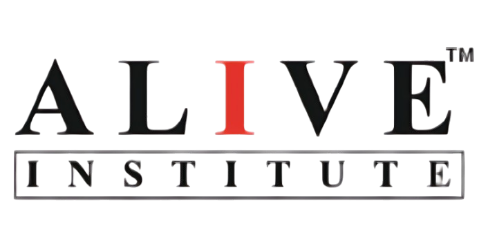

# alive institute indore - coaching website and ai learning portal




yo, so basically this is a complete redesign and fullstack concept platform for ALIVE Institute based in Indore (Madhya Pradesh). they got two main branches at usha nagar extension and airport road. thier current website was kinda slow and built on an old no-code builder, so i rebuilt teh whole thing from scratch to show what a modern coaching centre tech stack can actually look like.

tbh its not just a basic landing page, it has a working student dashboard, test engine, staff portal, and an interactive ai whiteboard canvas powered by google gemini vision and neon postgresql.

## what is inside this thing

### 1. public website
- clean editorial look with navy and terracotta brand colors (zero tailwind btw, all custom css tokens in variables.css because wanted full control over typography).
- courses catalogue for 6th to 12th grade covering cbse, icse and mp board (foundation, science pcm, pcb, commerce, cuet).
- real faculty profiles including founder gaurav gupta sir and senior teachers.
- campus details for both usha nagar and airport road branches with phone numbers, whatsapp links and enquiry forms.
- educational resources section with study guides and articles with proper schema markup for seo.

### 2. ai smart canvas whiteboard (the coolest part ngl)
- full interactive html5 drawing whiteboard where students can draw math equations, physics circuits, or optics diagrams.
- pen, eraser, straight line, vector, box, and circle tools with graph paper or lined grid toggles.
- quick formula presets for quadratic roots, calculus integrals, snell's law, and chemistry redox reactions.
- you can also upload a photo of your homework question directly from your phone or pc.
- clicks solve with alive ai -> sends the whiteboard sketch to gemini vision (using gemini-flash-lite-latest) which recognizes handwriting and outputs step-by-step board exam derivations, final answers in katex math, examiner trap warnings, and a practice question.
- saves your solved notes straight into neon postgresql so students never loose thier practice work.
- upstash redis handles query caching and rate limits so the api doesnt get spammed.

### 3. student test engine and portal
- full assessment engine with countdown timer, question pallete with color coded status (answered, review, unvisited).
- instant auto grading with percentage scorecards and step by step answer keys.
- saved questions bookmarking and performance tracking.

### 4. staff and admin dashboard
- staff console to create new tests with questions, manage course batches, check student list, and view incoming admission leads.
- admin user role switcher.

## tech stack used

- framework: next.js 16 app router with react 19 and typescript (strict mode)
- styles: 100% custom css using css variables, no tailwind or heavy ui runtime libs
- database: neon serverless postgresql (tested and workign)
- cache: upstash redis rest client
- ai: google gemini vision api (gemini-flash-lite-latest)
- math rendering: katex for crisp latex formulas

## how to run this on your machine

clone teh repo and install dependencies:

```bash
git clone https://github.com/NGSTRIKER/Demo-coaching-centre-website.git
cd alive-institute
npm install
```

copy the env template and fill in your keys (neon db, upstash redis, and gemini api key):

```bash
cp .env.example .env
```

start teh local dev server:

```bash
npm run dev
```

head over to `http://localhost:3000` in your browser.

to test the production build:

```bash
npx tsc --noEmit
npm run build
npm run start
```

## demo logins for testing

if you wanna try different dashboards quickly from the /login page:

- student demo: `student@demo.com` / `demo123`
- staff demo: `staff@demo.com` / `demo123`
- admin demo: `admin@demo.com` / `demo123`

## disclaimer

this is an independent concept redesign and tech demo created for ALIVE Institute Indore to showcase how a modern educational platform and ai smart board could work. not an official commissioned release.
